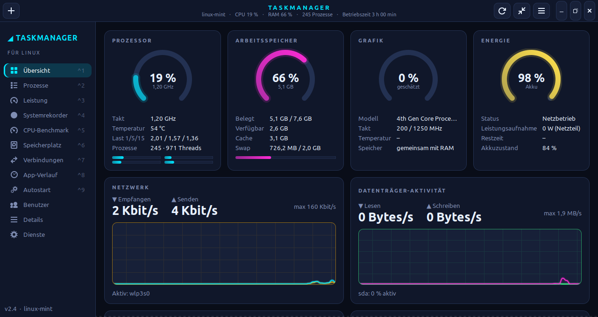
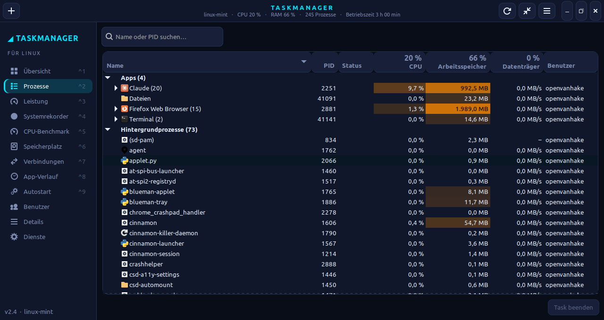
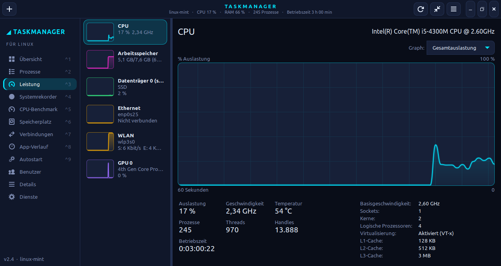
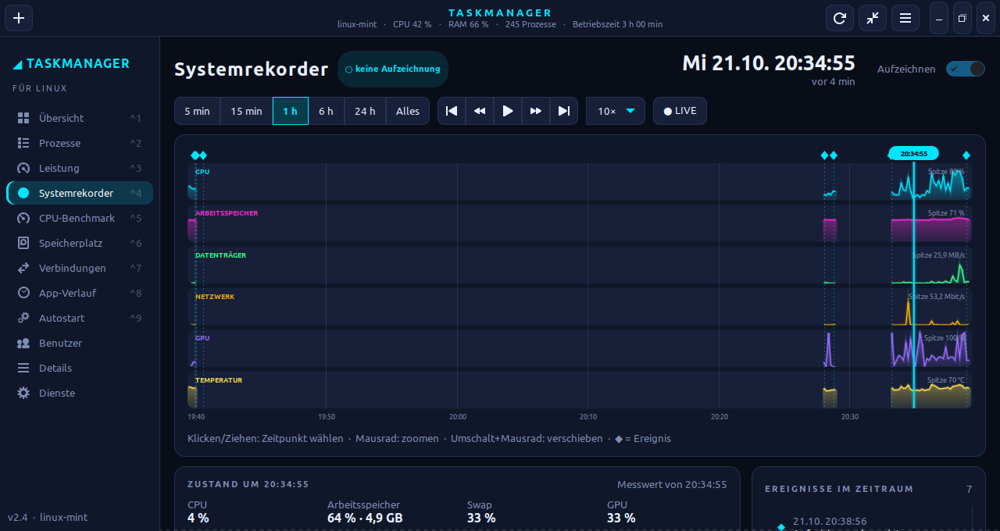
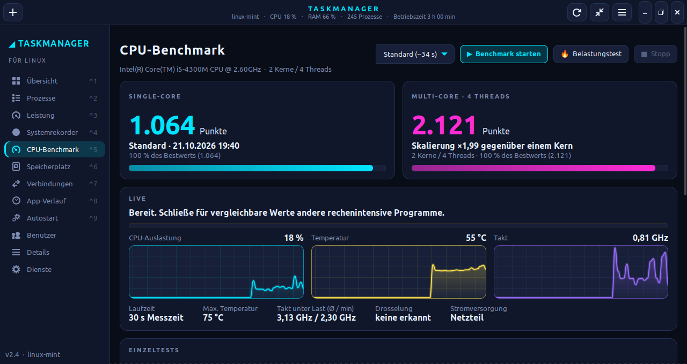
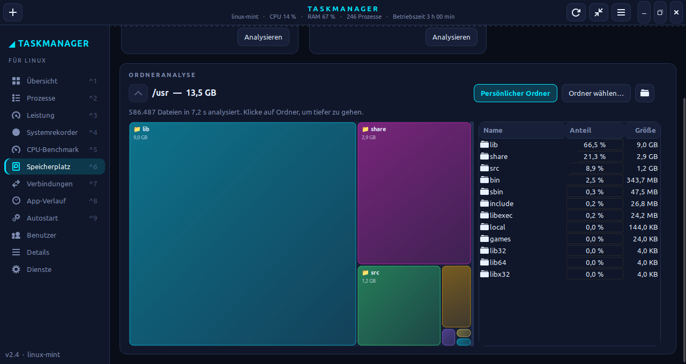
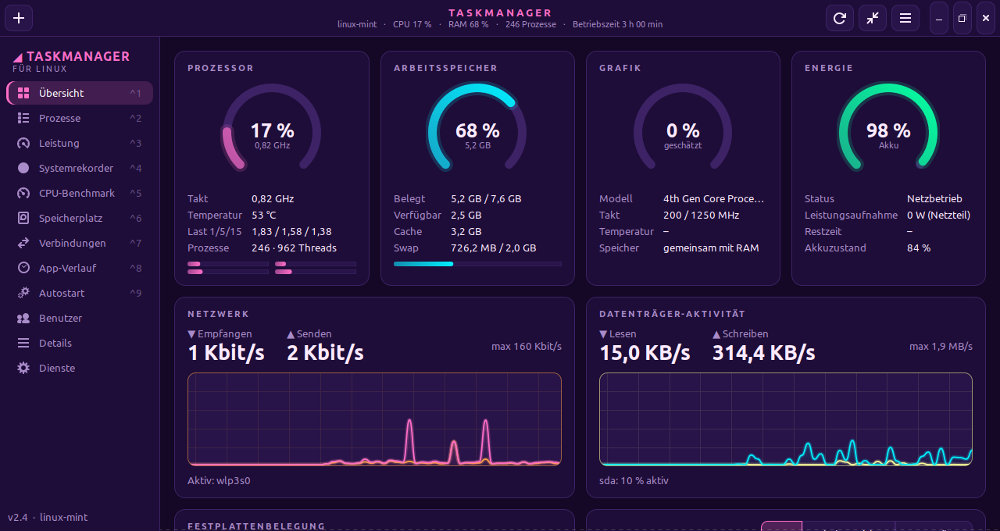
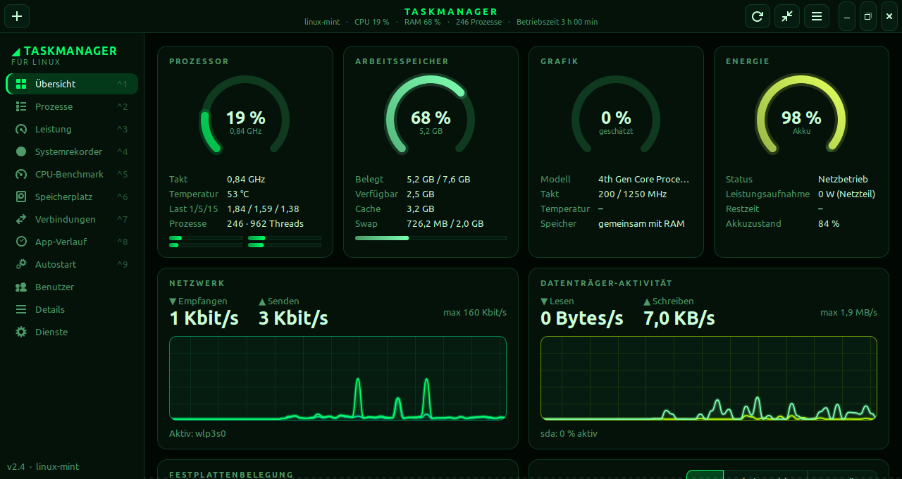
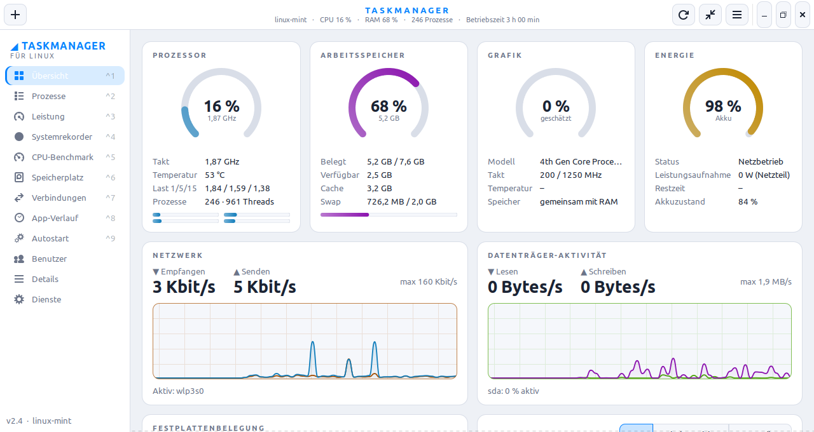
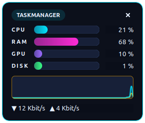

# Linux Taskmanager

**Ein moderner Taskmanager für Linux Mint** – inspiriert vom Windows-Taskmanager und von
[TMOG](https://www.omgubuntu.co.uk/2026/09/tmog-task-manager-linux-beta): Neon-Design, Dashboard,
Systemrekorder zum Zurückspulen, CPU-Benchmark, Festplattenanalyse und Mini-Modus.
**Deutsch und Englisch** (umschaltbar), ohne zusätzliche Pakete lauffähig.

> 🇬🇧 *English:* A modern task manager for Linux Mint with dashboard, system recorder, CPU benchmark and
> disk analysis. Switch the language via **☰ → Sprache / Language → English**.



---

## Inhalt

- [Funktionen](#funktionen)
- [Screenshots](#screenshots)
- [Voraussetzungen](#voraussetzungen)
- [Installation](#installation)
- [Bedienung](#bedienung)
- [Systemrekorder](#systemrekorder)
- [CPU-Benchmark](#cpu-benchmark)
- [Speicherplatz analysieren](#speicherplatz-analysieren)
- [Tastenkürzel](#tastenkürzel)
- [Rechte & Datenschutz](#rechte--datenschutz)
- [Grenzen](#grenzen)
- [Deinstallation](#deinstallation)
- [Projektaufbau](#projektaufbau)
- [Lizenz](#lizenz)

---

## Funktionen

| Seite | Inhalt |
|-------|--------|
| **Übersicht** | Dashboard mit Ringanzeigen für CPU, RAM, GPU und Akku, Last je Kern, Netzwerk- und Datenträger-Graph, Festplattenbelegung, Top-Prozesse und Systeminfos |
| **Prozesse** | Apps (mit Fenster, aufklappbar inkl. Kindprozessen), Hintergrund- und Systemprozesse; CPU, Arbeitsspeicher, Datenträger mit Farbhervorhebung; Suche; Task beenden |
| **Leistung** | Verlaufsgraphen für CPU (gesamt oder je logischem Prozessor), Arbeitsspeicher, jeden Datenträger, jeden Netzwerkadapter und die GPU – mit allen Kennzahlen |
| **Systemrekorder** | Zeichnet laufend auf und lässt dich zurückspulen: Zeitleiste mit Ereignissen (CPU-Spitzen, RAM knapp, Hitze …), Abspielen, Zustand und Top-Prozesse zu jedem Zeitpunkt |
| **CPU-Benchmark** | Single- und Multi-Core-Punktwerte aus 5 Testlasten, Live-Temperatur und -Takt, Drosselungserkennung, Belastungstest, Ergebnisverlauf |
| **Speicherplatz** | Belegung aller Laufwerke; Ordneranalyse als Treemap zum Hineinklicken |
| **Verbindungen** | Offene Netzwerkverbindungen je Prozess |
| **App-Verlauf** | Kumulierte CPU-Zeit und Datenträger-E/A je Programm |
| **Autostart** | Autostart-Einträge anzeigen, aktivieren/deaktivieren, hinzufügen, entfernen |
| **Benutzer** | Ressourcen je Benutzer, aufklappbar bis auf Prozessebene |
| **Details** | Alle Prozesse mit 18 wählbaren Spalten, Anhalten/Fortsetzen |
| **Dienste** | systemd-Dienste starten, beenden, neu starten, Autostart ein/aus |

Außerdem: **5 Farbschemata** (Neon, Synthwave, Matrix, Amber, Hell), ein **Mini-Modus** als
kleines, schwebendes Fenster und **zwei Sprachen** (Deutsch/Englisch).

---

## Screenshots

### Prozesse
Apps werden wie unter Windows mit ihren Unterprozessen gruppiert; hohe Werte sind farbig hervorgehoben.



### Leistung


### Systemrekorder
Zurückspulen wie bei einem Video – hier ist der Abspielkopf auf einen früheren Zeitpunkt gesetzt.



### CPU-Benchmark


### Speicherplatz


### Farbschemata

| Synthwave | Matrix | Hell |
|-----------|--------|------|
|  |  |  |

### Mini-Modus



---

## Voraussetzungen

- **Linux Mint 21.x** (Cinnamon, X11) – andere Ubuntu-basierte Systeme mit GTK 3 funktionieren in der Regel auch
- Python 3.8+, GTK 3, PyGObject, `psutil`, `libwnck3` – **auf Linux Mint bereits vorinstalliert**

Falls etwas fehlt (z. B. auf einem minimalen Ubuntu):

```bash
sudo apt install python3-gi python3-gi-cairo gir1.2-gtk-3.0 gir1.2-wnck-3.0 python3-psutil
```

---

## Installation

### 1. Herunterladen

```bash
git clone https://github.com/vanhake/LinuxTaskManager.git
cd LinuxTaskManager
```

### 2. Direkt starten (ohne Installation)

```bash
./taskmanager.sh
```

### 3. Installieren (empfohlen)

Legt einen Eintrag **„Taskmanager“** im Anwendungsmenü und den Befehl `taskmanager` an:

```bash
./install.sh
```

Mit Tastenkürzel **Strg+Umschalt+Esc** (wie unter Windows, nur Cinnamon):

```bash
./install.sh --shortcut
```

> Der Projektordner wird nicht kopiert – der Starter verweist auf ihn. Ordner also nach der
> Installation nicht verschieben (sonst `./install.sh` erneut ausführen).

---

## Bedienung

- **Navigation:** Seitenleiste links oder **Strg+1 … Strg+0**
- **Menü (☰ oben rechts):** Farbschema, **Sprache / Language** (Automatisch, Deutsch, English),
  Aktualisierungsgeschwindigkeit (0,5 s / 1 s / 4 s / angehalten), Prozesse nach Typ gruppieren,
  Immer im Vordergrund, Über
- **Sprache wechseln:** ☰ → Sprache / Language → gewünschte Sprache → „Jetzt neu starten“.
  „Automatisch“ richtet sich nach der Systemsprache (Deutsch bei deutschem System, sonst Englisch).
- **Kopfleiste:** ➕ neuen Task starten · ⟳ aktualisieren · Mini-Modus · Live-Werte in der Mitte
- **Prozess beenden:** Prozess markieren → **Entf** oder Button „Task beenden“
- **Rechtsklick auf einen Prozess:** Task beenden · Beenden erzwingen · Prozessbaum beenden ·
  Priorität festlegen · Dateispeicherort öffnen · Online suchen · Zu Details wechseln · Eigenschaften
- **Mini-Modus (Strg+M):** kleines Fenster immer im Vordergrund; ziehen zum Verschieben,
  Doppelklick öffnet wieder das große Fenster
- **Details → „Spalten auswählen“:** Spalten ein-/ausblenden (wird gespeichert)

---

## Systemrekorder

Der Systemrekorder speichert laufend den Systemzustand, damit du **nachträglich** sehen kannst,
was passiert ist – z. B. warum der Lüfter vorhin hochgedreht hat.

1. Seite **Systemrekorder** öffnen – „● REC“ zeigt, dass aufgezeichnet wird (Schalter „Aufzeichnen“ oben rechts).
2. Zeitraum wählen (**5 min … 24 h, Alles**), mit dem **Mausrad zoomen**, mit **Umschalt+Mausrad verschieben**.
3. In die Zeitleiste **klicken oder ziehen** → unten erscheinen alle Werte und die **Top-Prozesse zu genau diesem Zeitpunkt**.
4. **◆ Ereignisse** (CPU-Spitze mit Verursacher, RAM knapp, Hitze, Netzteil getrennt, Laufwerk fast voll …)
   anklicken oder mit ⏮ / ⏭ anspringen.
5. **▶ Abspielen** mit 1× bis 300×, **● LIVE** springt zurück zur Gegenwart.

**Dauerhaft aufzeichnen:** Haken bei **„Im Hintergrund aufzeichnen“** setzen. Dann läuft ein kleiner
Dienst (≈ 0,75 % CPU) auch ohne offenes Fenster und startet automatisch bei der Anmeldung.
Manuell: `./taskmanager.sh --recorder`

Aufbewahrung (1 h – 7 Tage), CSV-Export und Löschen findest du unten auf der Seite.

---

## CPU-Benchmark

1. Andere rechenintensive Programme schließen, Netzteil anschließen.
2. Modus wählen (**Schnell** ~19 s · **Standard** ~34 s · **Gründlich** ~64 s) → **▶ Benchmark starten**.
3. Ergebnis: **Single-Core-** und **Multi-Core-Punkte** plus Einzelwerte für Ganzzahl, Gleitkomma,
   Kryptografie, Kompression und Sortieren.

**1000 Punkte = ein Kern eines Intel Core i5-4300M.** Alle Läufe landen im Verlauf – ideal, um z. B.
vorher/nachher (neue Wärmeleitpaste, Energieprofil) zu vergleichen. Während des Tests werden
Temperatur, Takt unter Last und eine mögliche **Drosselung** angezeigt.

**🔥 Belastungstest:** lastet alle Threads aus, bis du **Stopp** drückst – gut, um Kühlung und
Stabilität zu prüfen.

---

## Speicherplatz analysieren

1. Seite **Speicherplatz** – oben siehst du alle Laufwerke mit Füllstand (gelb ab 80 %, rot ab 92 %).
2. **„Persönlicher Ordner“**, **„Ordner wählen…“** oder bei einem Laufwerk **„Analysieren“** klicken.
3. In der **Treemap** auf einen Ordner klicken, um hineinzugehen, **⬆** für zurück.
   Rechtsklick → „Im Dateimanager zeigen“.

Gezählt wird der tatsächlich belegte Platz; andere Partitionen/Netzlaufwerke werden nicht mitgezählt.

---

## Tastenkürzel

| Taste | Aktion |
|-------|--------|
| **Strg+1 … Strg+0** | Seite wechseln |
| **Strg+F** | Suchen (Prozesse, Details, Dienste …) |
| **Entf** | Ausgewählten Task beenden |
| **F5** | Jetzt aktualisieren |
| **Strg+N** | Neuen Task ausführen |
| **Strg+M** | Mini-Modus |
| **Strg+Q** | Beenden |
| **Strg+Umschalt+Esc** | Taskmanager öffnen (nach `./install.sh --shortcut`) |

---

## Rechte & Datenschutz

- Das Programm läuft als **normaler Benutzer**. Aktionen, die Root-Rechte brauchen (fremde Prozesse
  beenden, Priorität erhöhen, Systemdienste steuern), fragen über `pkexec` nach dem Passwort.
- Alle Daten bleiben **lokal** auf deinem Rechner:

| Datei | Inhalt |
|-------|--------|
| `~/.config/linux-taskmanager/settings.json` | Einstellungen |
| `~/.local/share/linux-taskmanager/systemrecorder.db` | Aufzeichnung des Systemrekorders |
| `~/.local/share/linux-taskmanager/benchmarks.json` | Benchmark-Ergebnisse |
| `~/.local/share/linux-taskmanager/app_history.json` | App-Verlauf |

Einzige Netzwerkaktion: „Online suchen“ im Kontextmenü öffnet eine Websuche im Browser – nur auf Klick.

---

## Grenzen

- Netzwerk-, GPU- und Energiewerte **pro Prozess** stellt Linux ohne Root nicht bereit.
- Datenträger-Raten fremder Prozesse sind gesperrt (Anzeige „–“).
- Intel-GPU-Auslastung wird über die Taktrate **geschätzt** (echte Werte nur mit Root über `intel_gpu_top`).
- RAM-Geschwindigkeit/Steckplätze nur mit Root (`dmidecode`).
- Unter **Wayland** gibt es keine „Apps“-Gruppe (Fensterzuordnung nur unter X11).

---

## Deinstallation

```bash
./install.sh --uninstall
```

Entfernt Menüeintrag, Befehl und Tastenkürzel. Einstellungen und Aufzeichnungen bleiben erhalten;
ganz löschen mit:

```bash
rm -r ~/.config/linux-taskmanager ~/.local/share/linux-taskmanager
```

Falls der Hintergrunddienst des Systemrekorders aktiv war: vorher in der App den Haken
„Im Hintergrund aufzeichnen“ entfernen.

---

## Projektaufbau

```
taskmanager/
├── app.py          Hauptfenster, Navigation, Menü
├── sampler.py      Messung in Hintergrund-Thread (psutil, /proc, /sys)
├── recorder.py     Systemrekorder (SQLite, Ereigniserkennung, Hintergrunddienst)
├── benchmark.py    CPU-Benchmark und Belastungstest (multiprocessing)
├── theme.py        Farbschemata und GTK-CSS
├── i18n.py         Sprachumschaltung, Funktion _()
├── locale_en.py    Englische Übersetzung (Schlüssel = deutscher Text)
├── widgets.py      Graphen, Ringanzeigen, Balken, Treemap
└── tabs/           eine Datei je Seite
```

Weitere Dokumentation: [Anforderungen](ANFORDERUNGEN.md) · [Umsetzungsplan](UMSETZUNGSPLAN.md)

Gebaut mit Python 3, GTK 3 (PyGObject), Cairo und psutil.

---

## Lizenz

Copyright © 2026 vanhake

Dieses Programm ist freie Software: Du kannst es unter den Bedingungen der
**GNU General Public License Version 3** (oder, nach deiner Wahl, jeder späteren Version)
weitergeben und/oder verändern. Veränderte Versionen müssen ebenfalls unter der GPL
mit Quelltext weitergegeben werden.

Die Veröffentlichung erfolgt in der Hoffnung, dass das Programm nützlich ist, aber **ohne jede
Gewährleistung**. Details siehe [LICENSE](LICENSE) bzw. <https://www.gnu.org/licenses/gpl-3.0.html>.
